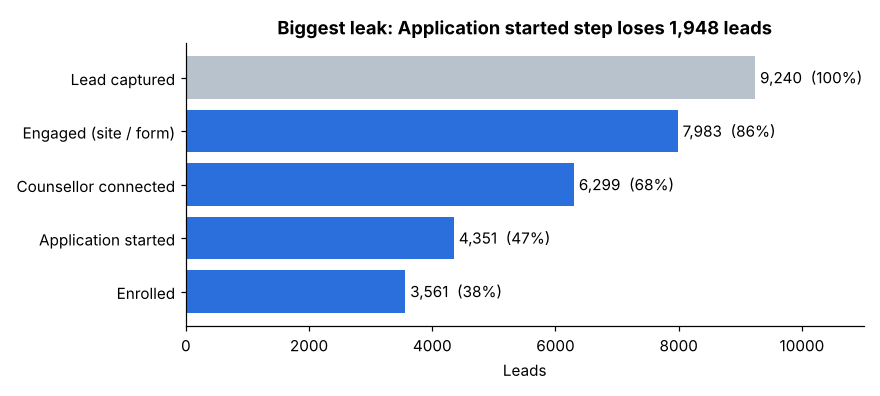
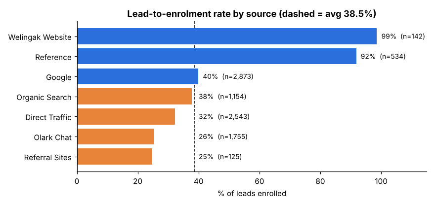
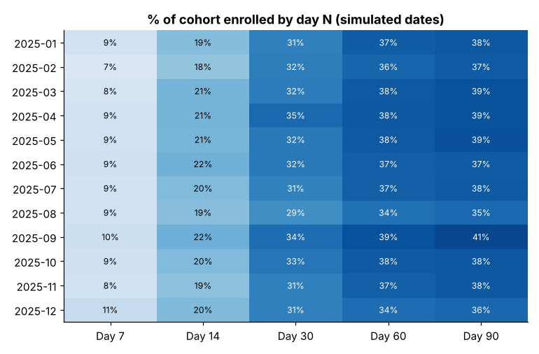
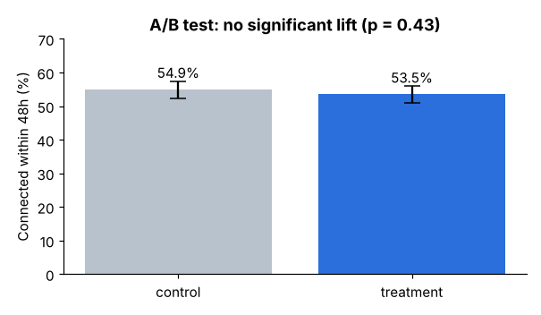

# Student Enrollment Funnel, Cohort & A/B Test Analysis

**SQL · Python (Pandas) · Looker Studio · A/B testing**

An online-education company gets thousands of leads but fewer than 4 in 10 enrol. This project answers three questions the admissions, counselling and growth teams would ask:

1. **Where in the admissions funnel do prospective students drop out?**
2. **Which channels bring students who actually enrol, not just leads?**
3. **Did a WhatsApp reminder before the counselling call improve connection rates?**

📊 **Live dashboard:** _Looker Studio link - coming soon_
📓 **Full analysis:** [`notebooks/analysis.ipynb`](notebooks/analysis.ipynb)

---

## Key findings

| # | Finding | So what |
|---|---------|---------|
| 1 | **The application step leaks the most:** 1,948 leads were counselled but never started an application, and 1,684 were never reached by a counsellor (mostly *Ringing / switched off / invalid number*). Overall, 38.5% of 9,240 leads enrol. | Validate phone numbers on the form (OTP) and follow up counselled leads within 48h with an application link. |
| 2 | **Volume ≠ quality.** Olark Chat brings 19% of leads but enrols only 26% of them; Reference leads enrol at 92% and Welingak at 99%. | Treat chat leads as nurture, not hot leads; invest in referral programmes. |
| 3 | **Referral leads are ~2x as likely to enrol within 30 days:** 68.5% of Reference leads enrolled within 30 days vs 34.5% for Google. | Use day-30 enrolment by channel as the weekly growth KPI, not lead count. |
| 4 | **Time on site predicts enrolment:** leads who spend 15+ min on the website enrol at 70% vs 14% for under 5 min. | Simple first lead score: call 15+ min leads first. |
| 5 | **The WhatsApp reminder showed no significant lift** (−1.5 pp, 95% CI −5.1 to +2.2 pp, p = 0.43). The test had only ~37% power to detect +3 pp. | Don't roll out yet. Re-run with ~4,300 leads per arm. |




| Cohort enrolment by day N | A/B test |
|---|---|
|  |  |

---

## Data

**Source:** X Education lead-scoring dataset (UpGrad case study, widely mirrored on Kaggle/GitHub): 9,240 real leads from an online-course company, 37 columns.

**Real:** lead origin, lead source, occupation, website visits, time on site, last activity, counsellor tags, **enrolment outcome**.

**Simulated (seeded, `SEED = 42`)** because the public data has no timestamps, stage history or experiments:

| Field | How it's simulated |
|---|---|
| `lead_created_date` | Spread over Jan-Dec 2025 with an admission-season peak (May-Jul) |
| `enrolled_date` | Lead date + log-normal delay (median ~12 days, 1.5x slower for low-engagement leads) |
| `application_started` | Always 1 for enrolled leads; for others, probability rises with time on site |
| `ab_group`, `call_connected_48h` | Sep-Dec 2025 leads split 50/50 at random |

So findings 2 and 4 come from real data only. Findings 1, 3 and 5 use the simulated fields and show the *method*.

## How it works

```
data/raw/Leads.csv
   │  src/build_tables.py   -> split into 3 "source systems" + simulate missing fields
   ▼
SQLite: crm_leads · web_activity · counselling_log
   │  src/run_sql.py        -> runs sql/01..06
   ▼
data/processed/*.csv        -> Looker Studio data sources
   │  notebooks/analysis.ipynb
   ▼
cohort tables · A/B test · charts · recommendations
```

| File | What it does |
|---|---|
| `sql/01_clean_join.sql` | Joins the 3 tables; cleans placeholders (`Select`), fixes source spelling (`google` → `Google`), groups tiny sources, caps visit outliers at p99, de-duplicates, builds funnel flags |
| `sql/02_funnel.sql` | 5-stage funnel with step conversion and drop-off (window functions) |
| `sql/03_source_performance.sql` | Funnel and share of enrolments by channel |
| `sql/04_engagement.sql` | Enrolment by time-on-site band |
| `sql/05_cohorts.sql` | Monthly cohort enrolment by day 7/14/30/60 |
| `sql/06_ab_test.sql` | A/B counts by group |
| `notebooks/analysis.ipynb` | Data-quality checks, Pandas cohort heatmap, channel cohorts, A/B test (SRM check, z-test, CI, power), recommendations |

### Data-quality checks (all pass)

No duplicate leads; every enrolled lead has an enrolment date after the lead date; every funnel stage is a subset of the previous one; the A/B split passes the sample-ratio-mismatch check (p = 0.29).

## Run it

```bash
pip install -r requirements.txt
python src/build_tables.py
python src/run_sql.py
jupyter notebook notebooks/analysis.ipynb
```
